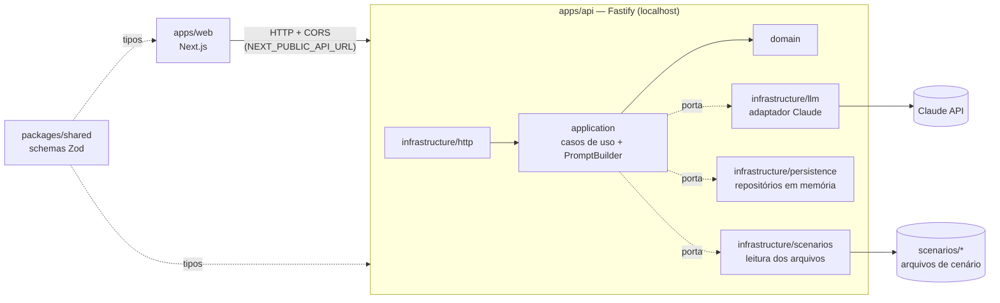
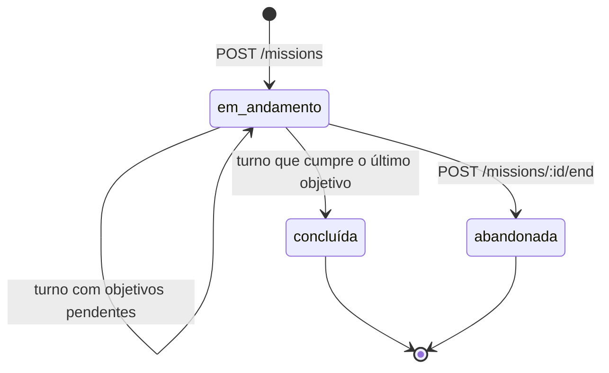
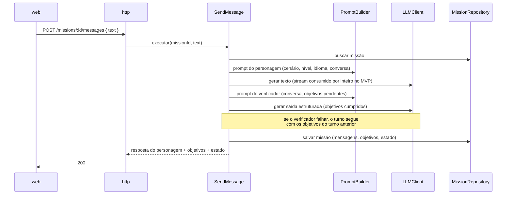

# Documento de Arquitetura — app de idiomas (MVP)

Oct 4, 2026 · @Gabriel · Status: **vigente**

> **Papel deste documento.** É a referência técnica do projeto: define *como* o sistema é construído. O vocabulário do domínio está em [`CONTEXT.md`](../CONTEXT.md), e as decisões difíceis de reverter, com o porquê de cada uma, estão em [`docs/adr/`](./adr/). O *quê* (user stories e critérios de aceite) fica na spec gerada pelo `/to-spec`.
>
> A versão anterior deste documento, junto com o PRD e o roadmap originais, está em [`docs/archive/`](./archive/).

---

## 1. Objetivo do MVP

Validar o ciclo central do produto com um único aluno (o autor), rodando localmente:

**Missão** (conversa com o personagem até cumprir os objetivos) → **relatório** (correções) → **"Quero treinar"** (a palavra é guardada para o treino futuro).

- Um cenário: a cafeteria (pedir a bebida, o tamanho, para viagem ou não, e a forma de pagamento).
- Idioma-alvo inglês e nível C1, fixos no MVP, mas tratados como parâmetros.
- Sem login, sem persistência externa, só texto (sem áudio).

O projeto também é um campo de estudo de arquitetura: cada fronteira existe para permitir novos cenários, modos, idiomas, níveis, áudio e persistência sem reescrever o núcleo.

---

## 2. Decisões

| Tema | Escolha | ADR |
| --- | --- | --- |
| Correções | Só no relatório; o personagem fica sempre em personagem | [013](./adr/013-correcoes-so-no-relatorio.md) |
| Fim da missão | Por objetivos, com verificador separado; botão "Encerrar" como saída | [014](./adr/014-tres-papeis-de-ia-e-fim-por-objetivos.md) |
| Estado | Em memória, atrás de repositórios | [008](./adr/008-estado-em-memoria-atras-de-repositorios.md) |
| IA | Porta `LLMClient` pronta para streaming, com a Claude API como primeiro adaptador | [016](./adr/016-llm-atras-de-porta-pronta-para-streaming.md) |
| Resposta HTTP | Completa no MVP; streaming (SSE) depois, só na camada HTTP | [016](./adr/016-llm-atras-de-porta-pronta-para-streaming.md) |
| Cenários e prompts | Arquivos validados com Zod; `PromptBuilder` por composição | [015](./adr/015-cenarios-como-dados-e-prompts-compostos.md) |
| Repositório | Monorepo pnpm com `apps/web`, `apps/api` e `packages/shared` | [012](./adr/012-monorepo-com-pacote-shared.md) |
| Camadas da API | `domain`, `application` e `infrastructure` (com `http` dentro), por contexto | [011](./adr/011-api-em-tres-camadas-por-contexto.md) |
| Servidor | Fastify, composition root manual, sem container de DI | [003](./adr/003-fastify-composition-root-manual.md) |
| Front → API | O navegador chama o Fastify direto, com CORS | [017](./adr/017-navegador-chama-a-api-direto.md) |
| Processos | Só a API; relatório sob demanda, separado do encerramento | [009](./adr/009-processo-unico-e-relatorio-sob-demanda.md) |
| Identidade | Nenhuma no MVP; a API escuta só em `localhost` | [010](./adr/010-sem-identidade-no-mvp.md) |
| Falhas do LLM | Retry e validação no adaptador; o verificador não derruba o turno | [016](./adr/016-llm-atras-de-porta-pronta-para-streaming.md), [014](./adr/014-tres-papeis-de-ia-e-fim-por-objetivos.md) |
| Testes | Determinísticos com fakes, mais evals sob demanda | §9 |
| Tooling | TypeScript strict, Vitest, Biome, Zod, `tsx` | §11 |
| Processo | Fatias verticais, um ADR por decisão difícil de reverter | §14 |

---

## 3. Visão geral



---

## 4. Estrutura do repositório

```
languageApp/
├── apps/
│   ├── web/                    # Next.js: telas, cliente tipado da API
│   └── api/
│       ├── src/
│       │   ├── domain/
│       │   ├── application/
│       │   ├── infrastructure/
│       │   └── main.ts         # sobe o Fastify a partir do composition root
│       ├── scenarios/          # um arquivo por cenário (dados, não código)
│       └── evals/              # casos dourados dos prompts (pnpm eval)
├── packages/
│   └── shared/                 # schemas Zod: DTOs HTTP e schema do cenário
├── docs/
│   ├── architecture.md         # este documento
│   ├── adr/
│   └── archive/                # plano original (v1), substituído
├── CONTEXT.md                  # glossário do domínio
└── CLAUDE.md                   # regras para as sessões do Claude Code
```

Os testes ficam ao lado do código (`*.test.ts`).

---

## 5. Camadas da API

```
apps/api/src/
├── domain/                     # TypeScript puro, sem bibliotecas
│   ├── missions/               # Mission, MissionStatus, Message, Objective
│   ├── evaluation/             # Report, Correction
│   ├── scenarios/              # Scenario, Persona
│   └── vocabulary/             # VocabularyItem
├── application/
│   ├── missions/               # StartMission, SendMessage, EndMission + MissionRepository
│   ├── evaluation/             # EvaluateMission
│   ├── vocabulary/             # SaveVocabularyItem + VocabularyRepository
│   ├── scenarios/              # ListScenarios + ScenarioRepository
│   ├── llm/                    # porta LLMClient e erros de LLM
│   └── prompts/                # PromptBuilder e blocos (papéis, nível, idioma)
└── infrastructure/
    ├── http/                   # rotas Fastify, validação, CORS, mapeamento de erros
    ├── llm/                    # ClaudeLLMClient (retry, timeout, validação Zod)
    ├── persistence/            # InMemoryMissionRepository, InMemoryVocabularyRepository
    ├── scenarios/              # FileScenarioRepository (lê e valida os arquivos)
    ├── config/                 # leitura e validação das variáveis de ambiente
    └── container.ts            # composition root único
```

Os nomes acima ilustram a organização. Os nomes finais saem da implementação, seguindo o [`CONTEXT.md`](../CONTEXT.md).

### Regras de dependência

| Camada | Pode importar | Não pode importar |
| --- | --- | --- |
| `domain` | Só `domain` | Qualquer biblioteca (inclusive Zod), `application`, `infrastructure` |
| `application` | `domain`, `application`, Zod (para os schemas da saída estruturada) | `infrastructure`, Fastify, SDK da Anthropic |
| `infrastructure` | Tudo acima, `packages/shared` e bibliotecas | — |

- Os **DTOs** de `packages/shared` são convertidos em objetos de domínio na borda (`infrastructure/http`). O domínio nunca recebe um DTO cru.
- As **portas** são interfaces declaradas em `application`, e os adaptadores as implementam em `infrastructure`.
- **Erros de domínio** (missão inexistente, missão já encerrada...) são classes com um código estável. Um único handler em `infrastructure/http` as traduz em status HTTP.

---

## 6. Fluxo da missão

### Estados



Uma missão `concluída` ou `abandonada` não aceita novas mensagens e pode gerar o relatório.

### Um turno



### Relatório

`POST /missions/:id/report` executa o `EvaluateMission`. Ele monta o prompt do avaliador com a conversa inteira, os objetivos, o nível e o idioma; pede uma saída estruturada; e guarda o relatório na missão. As chamadas seguintes devolvem o relatório guardado.

Cada **correção** traz: o trecho original, a forma recomendada, uma explicação curta, o tipo (`grammar`, `vocabulary` ou `naturalness`) e, nas de vocabulário, os campos que alimentam o treino futuro (`term`, `suggestedTerm`, `shouldPractice`).

---

## 7. API HTTP

| Método e rota | Caso de uso | Resposta |
| --- | --- | --- |
| `GET /scenarios` | `ListScenarios` | Cenários com título, descrição e objetivos |
| `POST /missions` | `StartMission` | A missão criada (id, estado, objetivos) |
| `GET /missions/:id` | — | O estado atual da missão (para recarregar a tela) |
| `POST /missions/:id/messages` | `SendMessage` | A resposta do personagem, os objetivos e o estado |
| `POST /missions/:id/end` | `EndMission` | O estado final |
| `POST /missions/:id/report` | `EvaluateMission` | O relatório (idempotente) |
| `POST /vocabulary-items` | `SaveVocabularyItem` | O item salvo a partir de uma correção ("Quero treinar") |
| `GET /vocabulary-items` | — | Os itens salvos (para inspeção, sem tela no MVP) |

Erros esperados:

| Situação | Status |
| --- | --- |
| Corpo inválido | 400 |
| Missão ou cenário inexistente | 404 |
| Mensagem para missão encerrada; relatório de missão em andamento | 409 |
| `InvalidLLMOutputError` (saída inválida depois das novas tentativas) | 502 |
| `LLMUnavailableError` (timeout ou provedor fora) | 503 |

As rotas `GET /missions/:id` e `/vocabulary-items` e o formato do corpo de erro são propostas, a confirmar na spec.

---

## 8. Cenários e prompts

**Arquivo de cenário** (um arquivo JSON por cenário em `apps/api/scenarios/`, validado pelo schema de `packages/shared` na inicialização):

- `id`, `title` e `description`
- `persona`: quem o personagem é e como fala (`name`, `role`, `speakingStyle`)
- `situation`: o contexto da cena
- `objectives`: a lista de objetivos, cada um com `id` e uma descrição verificável

O cenário não declara idioma nem nível: esses são parâmetros da missão.

**`PromptBuilder`**: uma função pura por papel, que junta blocos.

| Papel | Blocos |
| --- | --- |
| Personagem | Regras do papel (ficar em personagem, não corrigir, não falar pelo aluno) + nível + idioma + persona e situação + conversa |
| Verificador | Regras do papel + objetivos pendentes + conversa → schema "objetivos cumpridos" |
| Avaliador | Regras do papel + nível + idioma + objetivos + conversa → schema do relatório |

Novos níveis e idiomas são novos blocos. Novos cenários são novos arquivos.

---

## 9. Testes e evals

Os testes entram pela **seam mais alta possível** e verificam comportamento externo, não a estrutura interna.

| Seam | O que testa | O que é falso | Quando roda |
| --- | --- | --- | --- |
| **API HTTP** (principal) | O fluxo completo: cenários, missão, turnos, objetivos, conclusão, encerramento, relatório, "Quero treinar", validação e status de erro | Só o `LLMClient` (`FakeLLMClient`). Repositórios em memória e cenários (pasta de fixtures) são os adaptadores reais. Chamadas via `fastify.inject` | Todo commit |
| **Adaptador Claude** | Retry, timeout, rejeição de saída inválida e tradução para os erros de LLM | O transporte HTTP do SDK | Todo commit |
| **Cliente da API no front** | O cliente tipado e a lógica do chat (não a UI exaustivamente) | `fetch` | Todo commit |
| **Evals** | Qualidade dos prompts: o avaliador encontra o erro esperado, o verificador marca o objetivo certo, o personagem não corrige | Nada (Claude API real) | Sob demanda: `pnpm eval` |

Testes unitários diretos ficam só para regras puras difíceis de exercitar pela API, como os blocos do `PromptBuilder` e as mensagens de erro da validação de cenários.

Regras:

- **TDD** (red → green → refactor), começando pela seam HTTP.
- **A Claude API nunca é chamada na CI.** Só os evals a usam, rodados manualmente.
- **Os evals verificam estrutura, não texto exato.** Por exemplo: o JSON é válido e a correção esperada aparece. Começam com 5 a 10 casos dourados e entram junto da fatia que cria o prompt correspondente.
- **Não há mock de biblioteca.** O que precisa ser falso é uma porta, e tem um fake.

---

## 10. Tratamento de falhas

| Falha | Onde é tratada | Comportamento |
| --- | --- | --- |
| Timeout ou erro transitório do provedor | Adaptador Claude | Até 2 novas tentativas; depois, `LLMUnavailableError` |
| Saída estruturada que não passa no schema | Adaptador Claude | Até 2 novas tentativas; depois, `InvalidLLMOutputError` |
| Falha do personagem | Caso de uso → HTTP | O turno falha (503/502), nada é salvo e o aluno reenvia |
| Falha do verificador | Caso de uso `SendMessage` | A resposta do personagem é entregue com os objetivos do turno anterior, e um aviso é registrado no log |
| Falha do avaliador | Caso de uso → HTTP | O relatório falha (503/502) e o aluno tenta de novo; a missão não muda |
| Cenário inválido no disco | Inicialização | A API não sobe e informa qual arquivo e qual campo estão errados |

---

## 11. Tooling

| Área | Escolha |
| --- | --- |
| Linguagem | TypeScript `strict` em todos os pacotes |
| Pacotes | pnpm workspaces |
| Testes | Vitest (`fastify.inject` para as rotas) |
| Lint e formatação | Biome |
| Validação | Zod (contratos HTTP, cenários, saída do LLM e variáveis de ambiente) |
| Execução da API | `tsx` em desenvolvimento e para rodar localmente; `tsc` só no typecheck. O `packages/shared` é consumido como código-fonte TypeScript, sem build próprio. Um build emitido entra junto com o deploy, que está fora do MVP |
| Configuração | Um `config` por app, validado com Zod no boot; `.env.example` versionado |
| CI | GitHub Actions: lint → typecheck → testes (sem evals) |

Variáveis de ambiente previstas: `ANTHROPIC_API_KEY`, o modelo de cada papel, a porta da API, a origem permitida no CORS (API) e `NEXT_PUBLIC_API_URL` (web).

---

## 12. Pontos de extensão

| Evolução | O que muda | O que não muda |
| --- | --- | --- |
| Novo cenário | Um arquivo novo em `scenarios/` | Código |
| Novo nível ou idioma | Um bloco novo no `PromptBuilder` e a liberação do parâmetro | Cenários, casos de uso |
| Novo modo (por exemplo, correção em tempo real) | Novos blocos de papel e, se preciso, um caso de uso | O modo padrão |
| Streaming | A rota HTTP passa a usar SSE | Domínio, casos de uso, porta |
| Áudio | Portas `SpeechToText` e `TextToSpeech`, adaptadores e rotas | O motor da missão |
| Persistência | Adaptadores SQLite ou Postgres para os repositórios | Casos de uso |
| Login | Os casos de uso passam a receber o ator, e as entidades ganham dono | Os papéis de IA, os cenários |
| Treino (flashcard, frases de exemplo, uso numa frase) | Novo contexto `training` sobre os `VocabularyItem` | O avaliador (já produz os campos necessários) |
| Outro provedor de LLM | Um adaptador novo de `LLMClient` | Todo o resto |

---

## 13. Questões em aberto

| Questão | Quando decidir |
| --- | --- |
| O personagem abre a conversa ("Hi, what can I get you?") ou espera o aluno? | Spec |
| Formato do corpo de erro HTTP (por exemplo, `application/problem+json`) | Spec |
| Modelo da Claude para cada papel | Fatia 2 (com os evals) |
| Timeout e espera entre as novas tentativas do adaptador | Fatia 2 |
| Limite de turnos por missão, para conter o custo | Fatia 2 ou 3 |
| Ferramenta para verificar as regras de camada (dependency-cruiser). Por ora, um teste (`apps/api/src/architecture.test.ts`) verifica os imports de `domain` e `application` | Se o teste ficar insuficiente |
| Remover o spec-kit (`.specify/` e `.claude/skills/speckit-*`), já que o processo agora usa as skills do Matt Pocock | Antes da spec |

---

## 14. Plano de construção

Fatias verticais, cada uma atravessando todas as camadas, com testes:

1. Monorepo, tooling, `GET /scenarios` e a tela inicial.
2. Iniciar a missão e conversar com o personagem (primeiro com o `FakeLLMClient`, depois com a Claude), mais os primeiros evals.
3. Verificador de objetivos, conclusão automática e o botão "Encerrar".
4. Relatório do avaliador e a tela de relatório.
5. "Quero treinar": salvar o item de vocabulário.

Fluxo de trabalho, com as skills do Matt Pocock: `/to-spec` → `/to-tickets` (um ticket por fatia) → `/implement` com `tdd` → `code-review`.

---

## Governança

- Uma decisão difícil de reverter vira ADR em `docs/adr/`. Para mudá-la, crie um ADR novo que a substitui.
- Um termo novo do domínio entra no `CONTEXT.md` antes de aparecer no código.
- Este documento é atualizado no mesmo commit da mudança que ele descreve.
