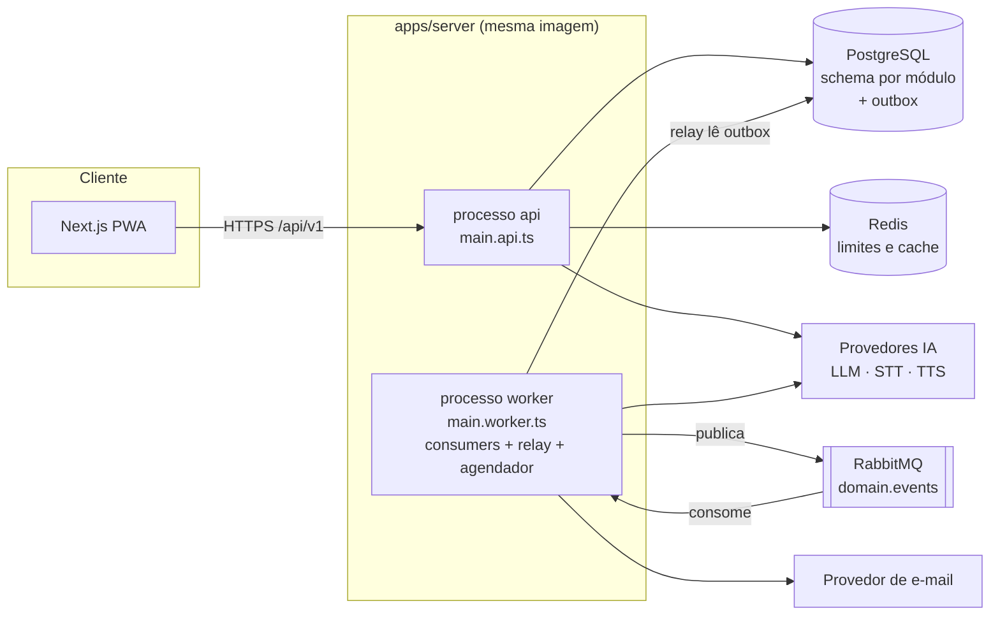
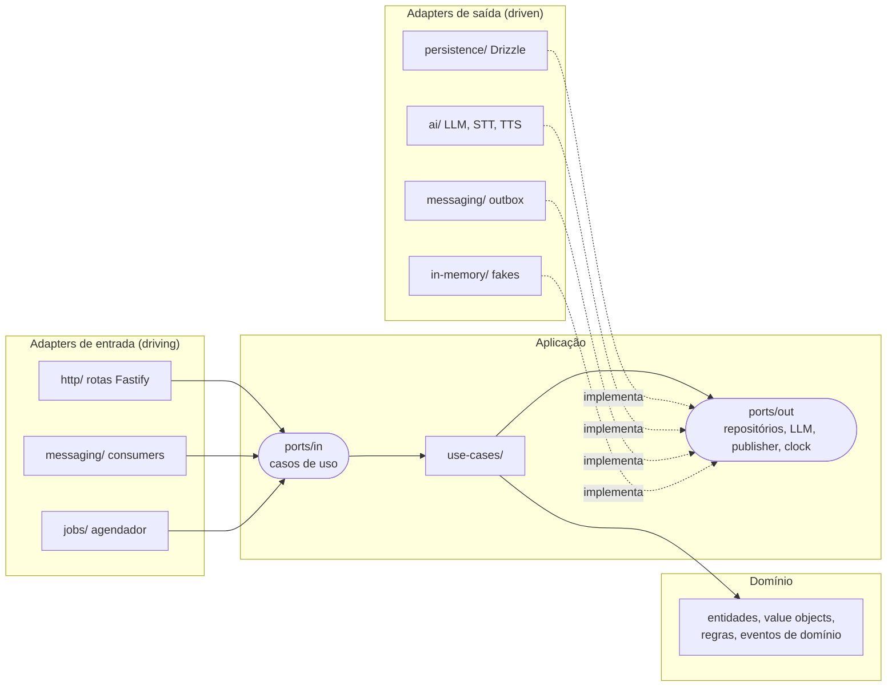
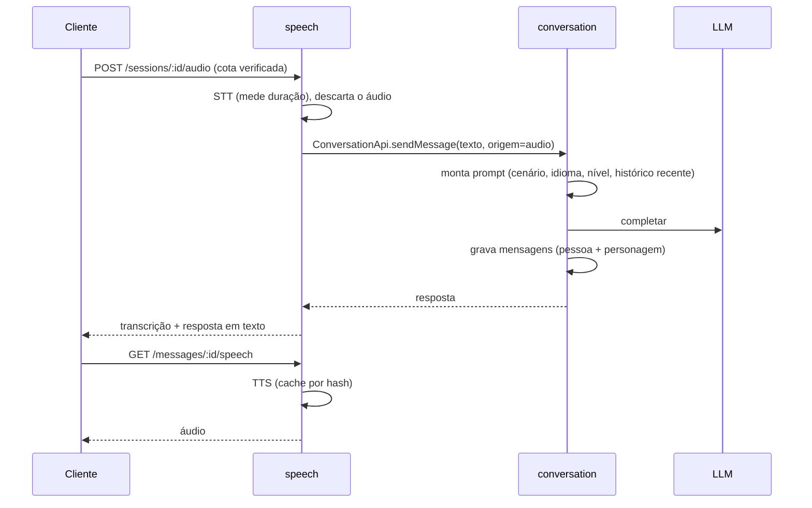

# Documento de Arquitetura — app de idiomas (MVP)

Oct 4, 2026 · @Gabriel · Status: **vigente** · Implementa: [`docs/prd.md`](./prd.md)

> **Papel deste documento.** É a referência técnica do projeto: define *como* o sistema é construído (arquitetura, fronteiras, padrões, testes e infraestrutura). O *quê* e o *porquê* ficam no PRD e nas specs de cada feature (`specs/###-*/spec.md`). No fluxo do spec-kit, os princípios inegociáveis daqui viram a **constitution** (`.specify/memory/constitution.md`) e o restante é insumo do `/speckit-plan`.
>
> Mudanças em decisões marcadas como **ADR** exigem um registro novo em `docs/adr/` (ver [Governança](#governança-e-adrs)).

---

## 1. Princípios

Estes princípios são inegociáveis e são verificados na CI sempre que possível.

| # | Princípio | Como é garantido |
| --- | --- | --- |
| P1 | **Monolito modular**: módulos com fronteira de serviço, um único deploy | `dependency-cruiser` quebra o build se um módulo importar arquivo interno de outro |
| P2 | **Arquitetura hexagonal dentro de cada módulo**: domínio no centro, sem dependência de framework, banco ou provedor | Regras de camada no `dependency-cruiser` |
| P3 | **Testes primeiro no domínio e na aplicação** (TDD): o teste falha antes do código existir | Revisão de PR + cobertura mínima nas camadas internas |
| P4 | **Dados por módulo**: cada módulo é dono do seu schema no Postgres; sem joins entre schemas | Repositórios só conhecem o próprio schema; revisão de migrations |
| P5 | **Comunicação explícita**: chamada síncrona pela API pública do módulo ou evento versionado | Contratos em `packages/contracts` com zod |
| P6 | **Confiabilidade de eventos**: outbox, entrega pelo menos uma vez, consumidores idempotentes | Teste de integração que entrega o mesmo evento duas vezes |
| P7 | **Custo de IA sob controle desde o dia 1**: limite diário, teto mensal e custo por sessão medido | Testes do limitador + métrica de custo |
| P8 | **Observável por padrão**: logs estruturados, trace ponta a ponta (HTTP → evento → worker), latência por etapa | Instrumentação nos adapters compartilhados |
| P9 | **Simplicidade (YAGNI)**: nada de serviço novo, abstração ou dependência sem motivo medido | Toda complexidade extra é justificada no plano da feature |

---

## 2. Visão geral e decisões

O MVP roda como um monolito modular em TypeScript: um código, dois processos (`api` e `worker`) e comunicação assíncrona por RabbitMQ. Cada módulo é um hexágono: o domínio não sabe que existe HTTP, Postgres, RabbitMQ ou LLM.

| Decisão | Escolha | Motivo | ADR |
| --- | --- | --- | --- |
| Arquitetura | Monolito modular + hexagonal por módulo | Itera rápido, treina fronteiras e permite extrair um módulo sem reescrever o domínio | 001 |
| Processos | `api` e `worker`, mesma base de código | Pratica trabalho assíncrono sem multiplicar repositórios | 002 |
| Servidor HTTP | **Fastify** com composition root manual (sem container de DI) | Mantém o domínio livre de decorators e deixa a ligação porta → adapter explícita, que é o ponto do exercício | 003 |
| Persistência | PostgreSQL + **Drizzle** (`pgSchema` por módulo) | SQL próximo do real, suporte direto a schemas e migrations por módulo | 004 |
| Mensageria | RabbitMQ (`amqplib`) com outbox | Exercita exchanges, ack manual, retries e DLQ | 005 |
| Fronteiras | **dependency-cruiser** | Expressa regras entre módulos *e* entre camadas num só lugar | 001 |
| Cliente | Next.js como PWA | Valida o ciclo em dias; Expo vem depois reaproveitando `contracts` | — |
| IA | APIs de LLM, STT e TTS atrás de portas | Provedor é detalhe de adapter; trocar não toca o domínio | 006 |
| Identidade | Usuário fixo até a semana 4, depois Google | Trocar o adapter de autenticação não toca os módulos | 007 |
| Primeira extração | `speech` ou `conversation` | Só com métrica que justifique (latência, custo ou escala) | — |

### Mudanças em relação à versão anterior (Tech Spec)

- **Módulo `core` dividido** em `identity` (usuário, perfil, autenticação) e `learning` (vocabulário, revisão, dias seguidos). `core` virava gaveta de tudo.
- **`audio` renomeado para `speech`**, que descreve o que o módulo faz (fala ↔ texto), não o formato.
- **Análise da sessão passa para `conversation`**, dono das mensagens, do cenário e dos objetivos. Antes, `core` precisaria ler as mensagens de outro módulo para analisar.
- **Estrutura hexagonal explícita** (portas de entrada/saída, adapters, composition root) no lugar de `domain/application/infra/http/events`.
- **Estratégia de testes por camada**, com testes de contrato de porta e fakes oficiais.
- **Envelope de evento padronizado**, DLQ por fila, evento de exclusão de conta (LGPD) e teto mensal de custo.
- Escolhas que estavam em aberto ("NestJS ou Fastify", "Drizzle ou Prisma", "dependency-cruiser ou eslint-plugin-boundaries") foram decididas.

---

## 3. Arquitetura de sistema



- A API grava dados de negócio e eventos (outbox) **na mesma transação**.
- O relay, dentro do worker, publica os eventos pendentes no RabbitMQ.
- Os consumers do worker processam as filas; API e worker só conversam via banco (outbox) e broker.
- O que a pessoa espera na hora (resposta do personagem, transcrição) é síncrono dentro da requisição. Fila só para o que pode acontecer depois.

---

## 4. Módulos

| Módulo | Responsabilidade | Schema | Expõe (porta de entrada pública) | Depende de |
| --- | --- | --- | --- | --- |
| `identity` | Usuário, perfil (idioma-alvo, nível, fuso, autoplay), autenticação, exclusão de conta | `identity` | `IdentityApi` (`getProfile`, `resolveUser`) | — |
| `conversation` | Cenários, missões, sessões, mensagens, chamada ao LLM, análise pós-sessão, relatório, modo "usar a palavra" | `conversation` | `ConversationApi` (`sendMessage`, `getSuggestion`) | `identity`, `learning` (para buscar a palavra no modo prática) |
| `speech` | Transcrição (STT), síntese (TTS) e cache de áudio | `speech` | `SpeechApi` (`transcribe`, `synthesize`) | `conversation` (entrega o texto transcrito) |
| `learning` | Vocabulário pessoal, agenda de revisão (1/3/7/14), fila do dia, dias seguidos | `learning` | `LearningApi` (`getVocabularyItem`) | `conversation` (busca a sugestão ao salvar) |
| `notifications` | Lembrete diário por e-mail | `notifications` | — (só consome eventos) | `identity` |

Regras de dependência entre módulos:

- Não pode haver ciclo de imports entre módulos (verificado pelo `dependency-cruiser`). Quando dois módulos precisam um do outro, um deles usa **evento** em vez de chamada.
- A "API pública" é um conjunto de portas de entrada exportadas pelo `index.ts`. Quando o módulo for extraído, ela vira um cliente HTTP com o mesmo contrato.

### Shared

```
apps/server/src/shared/
├── kernel/          # tipos sem dependência: UserId, Clock, DomainError, Result, ids
└── infra/           # implementações técnicas reutilizadas por adapters
    ├── db/          # conexão Drizzle, UnitOfWork, migrations runner
    ├── messaging/   # conexão RabbitMQ, outbox writer, relay, consumer base (retry, DLQ, idempotência)
    ├── cache/       # cliente Redis
    ├── ai/          # clientes HTTP dos provedores (sem regra de negócio)
    ├── http/        # bootstrap Fastify, tratamento de erro, plugins de auth e cota
    ├── observability/ # pino, OpenTelemetry, métricas
    └── config/      # leitura e validação de env (zod)
```

`shared/kernel` pode ser importado por qualquer camada. `shared/infra` **só** por adapters e composition roots, nunca por `domain` ou `application`.

---

## 5. Arquitetura hexagonal dentro do módulo



### Estrutura de pastas (igual em todos os módulos)

```
modules/learning/
├── domain/                     # TypeScript puro: sem I/O, sem framework, sem zod
│   ├── vocabulary-item.ts      # entidade
│   ├── review-schedule.ts      # regra 1/3/7/14, acerto avança, erro volta a 1
│   ├── streak.ts
│   ├── events.ts               # eventos de domínio (objetos simples)
│   └── errors.ts               # erros de domínio tipados
├── application/
│   ├── ports/
│   │   ├── in/                 # interfaces dos casos de uso (o que o módulo oferece)
│   │   └── out/                # interfaces do que o módulo precisa (repo, clock, llm, publisher)
│   └── use-cases/              # orquestram domínio + portas de saída; uma classe/função por caso de uso
├── adapters/
│   ├── in/
│   │   ├── http/               # rotas: valida com zod (contracts), chama porta in, mapeia resposta
│   │   ├── messaging/          # consumers: desserializa envelope, chama porta in
│   │   └── jobs/               # tarefas agendadas
│   └── out/
│       ├── persistence/        # tabelas Drizzle do schema "learning" + repositórios
│       ├── ai/                 # implementação das portas de IA usando shared/infra/ai
│       └── in-memory/          # fakes oficiais das portas de saída (testes e dev offline)
├── module.ts                   # composition root: instancia adapters e injeta nos casos de uso
└── index.ts                    # API pública: portas in públicas, tipos e register(api|worker)
```

### Regras de camada

| Camada | Pode importar | Não pode importar |
| --- | --- | --- |
| `domain` | `domain` do próprio módulo, `shared/kernel` | Qualquer outra coisa (inclusive `zod`, `drizzle`, `fastify`, `contracts`) |
| `application` | `domain`, `application`, `shared/kernel` | `adapters`, `shared/infra`, outros módulos |
| `adapters` | `application`, `domain`, `shared/*`, `packages/contracts`, `index.ts` de outro módulo | Arquivos internos de outro módulo |
| `module.ts` | Tudo dentro do próprio módulo, `shared/*`, `index.ts` de outro módulo | Arquivos internos de outro módulo |
| `index.ts` | `application/ports/in`, `module.ts`, tipos públicos | — |

Convenções:

- **Casos de uso recebem o ator explicitamente** (`{ userId, ... }`). Quem resolve o usuário é o adapter HTTP, via `IdentityApi.resolveUser`. Não existe "usuário ambiente" dentro da aplicação.
- **Tempo e aleatoriedade são portas** (`Clock`, `IdGenerator`). Regras de revisão, dias seguidos e reset de cota dependem de data e fuso, então precisam ser testáveis com relógio falso.
- **Erros**: o domínio lança subclasses de `DomainError` com `code` estável (`DAILY_LIMIT_REACHED`, `SESSION_ALREADY_ENDED`...). Um único handler em `shared/infra/http` converte para `application/problem+json` com o status correto. Erro técnico de provedor vira `ProviderUnavailableError` no adapter.
- **Transação e outbox**: a aplicação usa a porta `UnitOfWork.run(fn)`. O adapter Drizzle abre a transação, entrega repositórios e o `EventPublisher` ligados a ela, e o publisher grava no outbox. Assim "dado + evento" é atômico sem a aplicação conhecer SQL.
- **DTOs na borda**: `packages/contracts` (zod) define o formato de HTTP e eventos. O adapter converte DTO ↔ objeto de domínio; o domínio nunca recebe um DTO cru.
- **Prompts são código de domínio/aplicação puro**: a montagem do prompt (cenário, idioma, nível, histórico) é uma função pura testável; o adapter de LLM só envia texto e devolve texto/JSON validado.

---

## 6. Estrutura do repositório

```
idiomas/
├── apps/
│   ├── web/                       # Next.js PWA
│   └── server/
│       ├── src/
│       │   ├── main.api.ts        # sobe HTTP: registra rotas de cada módulo
│       │   ├── main.worker.ts     # sobe consumers, relay do outbox e agendador
│       │   ├── modules/
│       │   │   ├── identity/
│       │   │   ├── conversation/
│       │   │   ├── speech/
│       │   │   ├── learning/
│       │   │   └── notifications/
│       │   └── shared/
│       │       ├── kernel/
│       │       └── infra/
│       ├── test/
│       │   ├── e2e/               # API real + Testcontainers
│       │   └── support/           # builders, fixtures, helpers de containers
│       └── .dependency-cruiser.cjs
├── packages/
│   ├── contracts/                 # DTOs HTTP e eventos (zod), versionados
│   └── config/                    # tsconfig, eslint, vitest base
├── docs/
│   ├── prd.md
│   ├── architecture.md            # este documento
│   └── adr/                       # decisões registradas
├── specs/                         # gerado pelo spec-kit, uma pasta por feature
└── docker-compose.yml             # postgres, redis, rabbitmq (+ mailpit em dev)
```

Testes unitários e de aplicação ficam ao lado do código (`*.test.ts`); integração e e2e ficam em `apps/server/test/`.

---

## 7. Stack

| Camada | Escolha |
| --- | --- |
| Linguagem | TypeScript (strict), Node.js LTS |
| Monorepo | pnpm workspaces |
| Cliente | Next.js (PWA), TanStack Query |
| Servidor | Fastify, composition root manual |
| Banco | PostgreSQL + Drizzle, migrations por módulo |
| Mensageria | RabbitMQ com `amqplib` |
| Cache e limites | Redis |
| Contratos | `packages/contracts` com zod |
| Fronteiras | dependency-cruiser |
| Observabilidade | OpenTelemetry, `pino` (JSON) |
| Testes | Vitest, Testcontainers (Postgres, RabbitMQ, Redis), Playwright (smoke e2e no cliente), k6 (carga) |
| Ambiente local | Docker Compose (+ Mailpit para e-mail) |
| CI | GitHub Actions |

---

## 8. Estratégia de testes

O objetivo é que a maior parte dos testes rode em milissegundos sem Docker, graças às portas. Infraestrutura real só aparece nos testes que verificam os próprios adapters.

| Nível | O que testa | Dependências | Onde | Quando roda |
| --- | --- | --- | --- | --- |
| **Domínio** (unitário) | Regras puras: intervalos de revisão, dias seguidos no fuso, avaliação de cota, montagem de prompt | Nenhuma (nem mocks) | `domain/*.test.ts` | Todo commit |
| **Aplicação** | Casos de uso com fakes `in-memory` das portas de saída e `FakeClock` | Fakes oficiais | `use-cases/*.test.ts` | Todo commit |
| **Contrato de porta** | Uma mesma suíte roda contra o fake e contra o adapter real, garantindo que o fake se comporta como o real | Testcontainers no adapter real | `adapters/out/**/*.contract.test.ts` | Todo PR |
| **Adapter de entrada HTTP** | Validação, status, mapeamento de erros, auth e cota | `fastify.inject` + fakes | `adapters/in/http/*.test.ts` | Todo commit |
| **Mensageria** | Outbox → relay → fila → consumer; idempotência (mesmo evento 2x); retry e DLQ; broker fora do ar não perde evento | Testcontainers (Postgres + RabbitMQ) | `test/integration/messaging` | Todo PR |
| **Arquitetura** | Fronteiras entre módulos e regras de camada | dependency-cruiser | CI | Todo commit |
| **E2E API** | Fluxos do PRD ponta a ponta com provedores de IA falsos (`ScriptedLlm`, `FakeStt`, `FakeTts`) | Testcontainers | `test/e2e` | Todo PR |
| **Smoke do cliente** | Abrir app, escolher cenário, trocar mensagem, ver resumo | Playwright contra ambiente local | `apps/web/e2e` | Main e antes de release |
| **Carga** | Latência p95 de texto/áudio e comportamento da cota | k6 | `perf/` | Manual, por semana |
| **Qualidade da IA** | Correções e avaliação de objetivos fazem sentido | Amostra revisada à mão; conjunto "golden" pequeno depois | `evals/` | Manual, fora da CI |

Regras:

- **TDD obrigatório em `domain` e `application`**: escrever o teste, ver falhar, implementar, refatorar.
- **Nada de mock de biblioteca** (Drizzle, amqplib, SDK de IA). Se algo precisa ser falso, é uma porta e tem um fake oficial em `adapters/out/in-memory`.
- **Provedores de IA nunca são chamados na CI.** Os fakes devolvem respostas roteirizadas; o adapter real tem um teste de contrato opcional (`pnpm test:providers`) rodado à mão com chave de teste.
- **Cobertura mínima**: 90% em `domain` + `application`; sem meta para adapters (são cobertos por contrato e e2e).
- **Builders de teste** (`aVocabularyItem().dueIn(3).build()`) em `test/support` para manter os testes legíveis.
- Critério de pronto de toda feature: testes da tabela acima aplicáveis existem e passam, e a CI está verde.

### Pipeline de CI

`install → lint → typecheck → depcruise → test:unit → test:integration (Testcontainers) → test:e2e → build`

Qualquer etapa vermelha bloqueia o merge.

---

## 9. Processos: API e worker

| Processo | Entrypoint | Faz | Escala por |
| --- | --- | --- | --- |
| `api` | `main.api.ts` | Recebe HTTP, autentica, aplica cota, chama casos de uso, grava no outbox | Tráfego |
| `worker` | `main.worker.ts` | Relay do outbox, consumers, agendador diário (revisões vencidas) | Tamanho das filas |

Cada módulo exporta `register({ mode: 'api' | 'worker', deps })`; o entrypoint chama o `register` de todos e só liga o que pertence àquele modo. O worker expõe apenas `/health` e `/metrics`.

Desenvolvimento local:

```
docker compose up -d                 # postgres, redis, rabbitmq, mailpit
pnpm --filter server db:migrate
pnpm --filter server dev:api         # terminal 1: HTTP na porta 3001
pnpm --filter server dev:worker      # terminal 2: relay, consumers e agendador
pnpm --filter web dev                # terminal 3: PWA
```

Variável `AI_PROVIDER=fake` liga os fakes de IA para desenvolver sem gastar orçamento.

Em produção é a mesma imagem Docker com comandos diferentes (`node dist/main.api.js` e `node dist/main.worker.js`).

---

## 10. Eventos e mensageria

### Envelope

Todo evento usa o mesmo envelope, definido em `packages/contracts`:

```ts
{
  eventId: string;        // uuid v7, chave de idempotência
  type: string;           // "conversation.session-ended"
  version: number;        // 1
  occurredAt: string;     // ISO 8601 UTC
  userId: string;
  traceparent?: string;   // W3C trace context, para o trace seguir até o worker
  payload: unknown;       // validado pelo schema zod do tipo+versão
}
```

### Eventos do MVP

| Evento | Publicado por | Fila do consumidor | O que acontece |
| --- | --- | --- | --- |
| `conversation.session-ended.v1` | conversation | `conversation.analyze-session` | Extrai erros e sugestões, avalia objetivos da missão, grava o relatório |
| `conversation.session-ended.v1` | conversation | `learning.record-activity` | Atualiza os dias seguidos |
| `learning.word-saved.v1` | learning | `learning.prepare-reviews` | Gera frases de contexto para a revisão (o agendamento 1/3/7/14 é feito na hora, na mesma transação) |
| `learning.reviews-due.v1` | learning (agendador diário) | `notifications.send-reminder` | Envia o e-mail, no máximo um por dia por pessoa |
| `identity.user-deleted.v1` | identity | `<módulo>.purge-user` (um por módulo) | Cada módulo apaga os dados da pessoa (LGPD) |

### Topologia no RabbitMQ

- Exchange `domain.events` (topic); routing key = `<type>.v<version>`.
- Uma fila por consumidor, ligada pela routing key.
- Retry: até 3 tentativas com espera crescente (filas `<fila>.retry.1|2|3` com TTL de 5 s, 30 s e 2 min, que devolvem à fila original por dead-letter).
- Depois da última tentativa, a mensagem vai para `<fila>.dlq` (uma DLQ por consumidor, para reprocessar só o que falhou). Um script `pnpm ops:dlq:replay <fila>` reenvia mensagens da DLQ.

### Garantias

- **Outbox**: evento gravado na mesma transação do dado de negócio; o relay publica com *publisher confirms* e só então marca `published_at`. Se o broker cair, nada se perde.
- **Pelo menos uma vez**: todo consumidor é idempotente.
- **Idempotência**: `platform.processed_events` com chave única (`event_id`, `consumer`), gravada na mesma transação do trabalho do consumidor; se a chave já existe, o evento é ignorado.
- **Ack manual**: só depois de a transação do consumidor ser confirmada.
- **Versionamento**: mudança incompatível gera `v2`; o publicador emite as duas versões enquanto houver consumidor de `v1`.

---

## 11. Modelo de dados

Um schema por módulo, sem joins nem foreign keys entre schemas. Referências entre módulos guardam só o id.

| Schema | Tabela | Campos principais |
| --- | --- | --- |
| `identity` | `users` | id, email (opcional até o login), nome, idioma_alvo, nível, fuso, autoplay, criado_em |
| `identity` | `auth_sessions` | id, user_id, expira_em (30 dias) |
| `conversation` | `scenarios` | id, slug, tipo (`mission` \| `free_topic`), idioma, prompt_base, briefing, objetivos (2 a 3) |
| `conversation` | `sessions` | id, user_id, scenario_id, modo (`scenario` \| `practice` \| `free`), vocabulary_item_id (prática), iniciada_em, encerrada_em |
| `conversation` | `messages` | id, session_id, papel, texto, origem (`text` \| `audio`), criada_em |
| `conversation` | `session_reports` | session_id, status (`pending` \| `ready` \| `failed`), erros (frase, correção, explicação), sugestões (até 5), objetivos (cumprido + frase que prova) |
| `conversation` | `correction_feedback` | id, session_id, item_ref, motivo, criado_em |
| `speech` | `speech_jobs` | id, message_id, tipo (`stt` \| `tts`), status, duração_ms, custo |
| `speech` | `tts_cache` | hash (texto + voz + idioma), storage_ref, criado_em |
| `learning` | `vocabulary_items` | id, user_id, termo, termo_normalizado, significado, exemplo, origem_session_id; único (user_id, idioma, termo_normalizado) |
| `learning` | `reviews` | id, item_id, vence_em, intervalo_dias, último_resultado |
| `learning` | `streaks` | user_id, dias_seguidos, último_dia (no fuso da pessoa) |
| `notifications` | `notification_log` | id, user_id, tipo, data_local, enviada_em; único (user_id, tipo, data_local) |
| `platform` | `outbox_events` | id, tipo, versão, payload, criado_em, publicado_em, tentativas |
| `platform` | `processed_events` | event_id, consumer, processado_em |
| `platform` | `ai_usage` | id, user_id, session_id, provedor, operação, unidades, custo_estimado, criado_em |

Observações:

- O áudio enviado pela pessoa **não é persistido**: fica em memória durante a transcrição e é descartado (PRD, privacidade).
- O schema `platform` guarda tabelas técnicas compartilhadas, não dados de negócio.
- O contador diário de mensagens fica no Redis com chave `quota:{userId}:{data_local}` e expiração na meia-noite do fuso da pessoa.

---

## 12. API HTTP

Todas as rotas ficam sob `/api/v1`, exigem autenticação (exceto login e health) e retornam erros como `application/problem+json`. Rotas marcadas com **$** passam pela cota diária antes de chamar qualquer provedor.

| Método e rota | Módulo | Função | RF |
| --- | --- | --- | --- |
| `POST /auth/google` | identity | Login com Google e criação da sessão (semana 4) | RF01 |
| `GET /me` · `PATCH /me` | identity | Ler e alterar idioma-alvo, nível, fuso e autoplay | RF02, RF06 |
| `DELETE /me` | identity | Excluir a conta e publicar `user-deleted` | LGPD |
| `GET /scenarios` | conversation | Listar cenários e temas livres, com briefing e objetivos | RF03, RF16, RF17 |
| `POST /sessions` | conversation | Iniciar sessão; devolve a fala de abertura do personagem | RF03 |
| `POST /sessions/:id/messages` **$** | conversation | Enviar texto e receber a resposta | RF04 |
| `POST /sessions/:id/audio` **$** | speech | Enviar áudio, transcrever e devolver transcrição + resposta | RF05 |
| `GET /messages/:id/speech` | speech | Obter o áudio da resposta (TTS, com cache) | RF06 |
| `POST /sessions/:id/end` | conversation | Encerrar e publicar `session-ended` | RF09 |
| `GET /sessions/:id/report` | conversation | Resumo; responde 202 enquanto a análise não terminou | RF07–RF09, RF16 |
| `POST /reports/:sessionId/feedback` | conversation | Reportar correção errada | Risco "IA corrige errado" |
| `POST /practice` **$** | conversation | Iniciar a missão "usar a palavra" | RF12 |
| `GET /vocabulary` · `POST /vocabulary` · `DELETE /vocabulary/:id` | learning | Listar, salvar ("treinar essa", sem duplicar) e remover | RF10 |
| `GET /reviews/due` | learning | Fila de revisão do dia | RF11 |
| `POST /reviews/:id/answer` | learning | Registrar acerto ou erro | RF11, RF14 |
| `GET /streak` | learning | Dias seguidos | RF14 |
| `GET /health` · `GET /metrics` | shared | Saúde e métricas | — |

**Autenticação antes da semana 4.** O adapter `FixedUserAuth` resolve sempre o usuário seed, mas exige o header `X-Dev-Token` (segredo em env) para que ninguém gaste o orçamento de IA. Na semana 4 entra `GoogleSessionAuth`, com o mesmo contrato da porta `IdentityApi.resolveUser`.

---

## 13. Fluxo de conversa e áudio



Ao encerrar, `POST /sessions/:id/end` grava a sessão encerrada e `session-ended` no outbox, na mesma transação. O worker de análise envia histórico + objetivos ao LLM (modelo menor), valida a resposta JSON com zod e grava o relatório.

**Latência.** Meta ponta a ponta: 8 s p95 (áudio) e 6 s p95 (texto). Cada etapa (STT, LLM, TTS) registra a própria duração; o orçamento por etapa é fixado depois da primeira semana de medição. Se passar da meta, a ordem de ataque é: devolver o texto antes da voz (já é o desenho), reduzir o histórico enviado ao LLM e, por fim, streaming.

**Idiomas.** O idioma-alvo é parâmetro de ponta a ponta: perfil → prompt → STT/TTS (`en-US`; espanhol `es-ES` ou `es-MX`, **a decidir**, ver [Questões em aberto](#16-questões-em-aberto)). Inglês e espanhol compartilham módulos, eventos e cenários; o espanhol é ligado por configuração (`ENABLED_LANGUAGES`). Se adicionar um idioma exigir código fora de configuração e prompts, a fronteira está errada.

---

## 14. Missões

Um cenário é **dado, não código**: prompt base, briefing e 2 a 3 objetivos, carregados por seed versionado. O briefing aparece antes da conversa. O personagem recebe só o contexto da cena, sem a lista de objetivos, para não entregar as respostas.

Ao fim da sessão, a análise avalia cada objetivo (cumprido ou não + frase da pessoa que prova). O modo "usar a palavra" é uma missão gerada na hora, com um único objetivo: usar o termo salvo corretamente. Avaliar objetivos durante a conversa fica para depois (custo e latência).

---

## 15. Custo, limites, segurança e observabilidade

**Custo e limites**

- Cota diária por pessoa (40 mensagens, proposta do PRD), verificada por um plugin Fastify nas rotas **$** antes de qualquer chamada a provedor. Ao estourar: `429` com `resetAt` no fuso da pessoa.
- Teto mensal global (R$ 100, proposta): `ai_usage` acumula custo estimado; alerta em 80% e bloqueio das rotas **$** em 100% (`503` com mensagem clara).
- Cache de TTS por hash (falas de abertura e frases repetidas).
- Modelo menor para análise pós-sessão e frases de contexto; modelo melhor só na conversa.
- Timeout e uma tentativa extra nas chamadas a provedores; depois disso, erro claro e o cliente oferece reenviar.

**Segurança e privacidade**

- Segredos só por variável de ambiente, validados no boot (`shared/infra/config`).
- Áudio descartado após transcrição; `DELETE /me` apaga todos os dados via `user-deleted` em todos os módulos.
- Logs não registram texto das mensagens nem e-mail em nível `info`.

**Observabilidade**

- Logs JSON (`pino`) com `trace_id`, `user_id` e `session_id`.
- Trace OpenTelemetry cobre a requisição e segue pelo `traceparent` do envelope até o worker.
- Métricas: duração por etapa (STT, LLM, TTS), tamanho das filas, mensagens na DLQ, falhas por provedor, custo por sessão, sessões iniciadas, palavras salvas, revisões concluídas (métricas de sucesso do PRD).
- Alertas: DLQ não vazia, p95 acima da meta, custo mensal acima de 80%.

---

## 16. Questões em aberto

| Questão | Dono | Prazo |
| --- | --- | --- |
| Variante do espanhol (`es-ES` ou `es-MX`) — o PRD marca como resolvida, mas não registra a escolha | @Gabriel | Antes da semana 3 |
| Provedores de LLM, STT e TTS e seus preços (base do custo por sessão) | @Gabriel | Pesquisa do `/speckit-plan` da feature 001 |
| Onde guardar o áudio de TTS cacheado (disco local, S3 compatível) | @Gabriel | Semana 2 |
| Provedor de e-mail | @Gabriel | Semana 3 |
| Hospedagem (VPS com Docker Compose, Fly.io, Railway...) | @Gabriel | Semana 4 |

---

## 17. Plano de execução e features do spec-kit

Cada semana vira uma ou mais features no spec-kit (uma fatia vertical testável ponta a ponta). Critério para avançar: o fluxo funciona no celular e a CI (testes + fronteiras) está verde. O detalhamento de cada fatia, os prompts e o tracking por sessão estão em [`docs/roadmap.md`](./roadmap.md).

| Semana | Features (spec-kit) |
| --- | --- |
| 1 | `001` conversa por texto + fundação |
| 2 | `002` conversa por áudio · `003` resumo da sessão (eventos + análise) |
| 3 | `004` vocabulário e revisão · `005` lembrete por e-mail · `006` espanhol |
| 4 | `007` login Google e LGPD · `008` missões, temas e "usar a palavra" · `009` métricas e lançamento |

---

## 18. Extração de um módulo para serviço próprio

Só acontece quando uma métrica justificar (latência, custo ou escala). Vale para `speech` ou `conversation`:

1. Criar `apps/speech-service` com o módulo inteiro (domínio, aplicação e adapters não mudam) e um `main.ts` próprio.
2. No monolito, trocar a implementação de `SpeechApi` por um cliente HTTP com o mesmo contrato (os testes de contrato da porta rodam contra ele).
3. Mover o schema `speech` para um banco próprio, com escrita dupla por um período.
4. Rodar os dois caminhos em paralelo (strangler) e desligar o antigo quando erro e latência confirmarem.
5. Contratos incompatíveis ganham `v2` sem quebrar quem consome `v1`.

Como o domínio e a aplicação nunca dependeram de infraestrutura, a mudança fica nos adapters e no deploy.

---

## Governança e ADRs

- Este documento e a constitution do spec-kit devem concordar. Se divergirem, a constitution vence e este documento é corrigido.
- Decisões marcadas com ADR ficam em `docs/adr/NNN-titulo.md` (contexto, decisão, consequências). Mudar uma delas exige um ADR novo que substitui o anterior.
- Todo `plan.md` de feature passa pelo *Constitution Check*; violação só com justificativa na seção de complexidade do plano.
